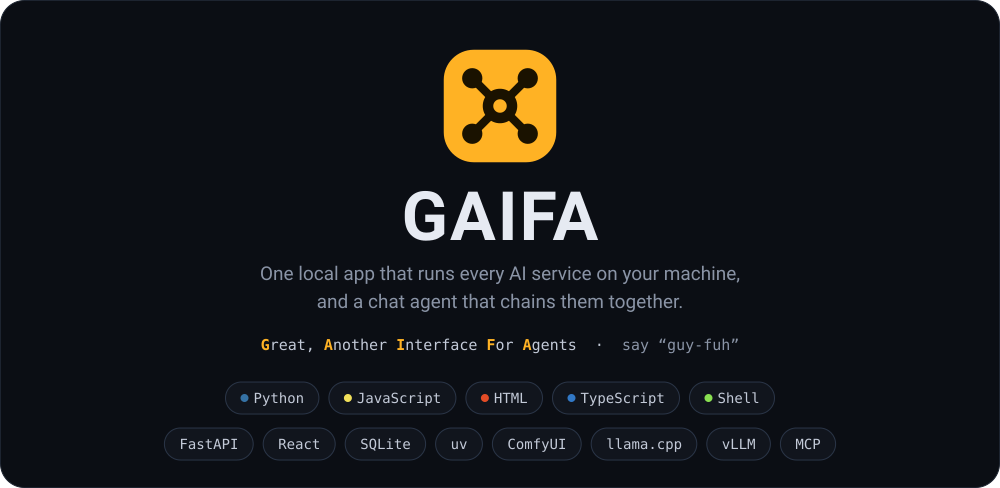
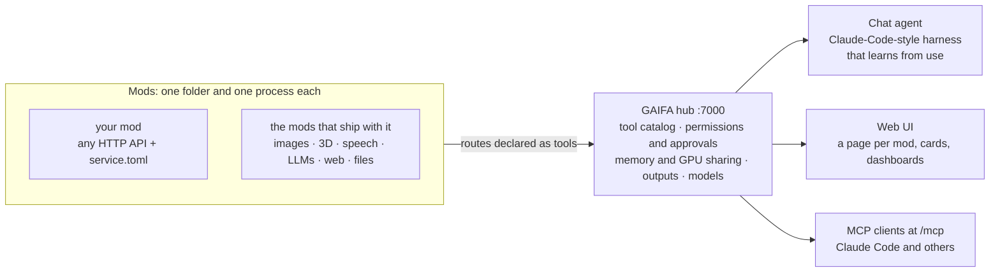
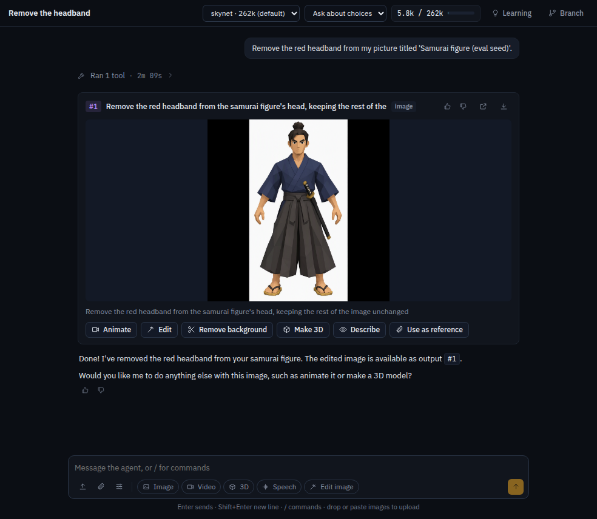

<p align="center">
  
</p>

<!-- The banner repeats the sentence below. Change one, change both, then run
     python3 docs/assets/make_header.py -->

**GAIFA** is a modular, local server for AI apps you build yourself. Each app is a **mod**: a small
web API in its own folder. List its routes as tools, and GAIFA serves them to a chat agent built the
way Claude Code is built, to its own web UI, and to any MCP client. The agent learns how you work as
you use it, and keeps revising its own instructions to match. The name stands for *Great, Another
Interface For Agents*, and it's said "guy-fuh".

If you want to **build on it**, start at [Build a mod](#build-a-mod). If you want to **run it**,
start at [Quickstart](#quickstart).

## How it fits together



The **hub** is a small FastAPI server on `127.0.0.1:7000`. It starts, stops and health-checks the mods,
proxies each one's API at `/api/s/<id>/`, and gathers the tools every mod declares into one catalog.
That catalog is what the agent calls, what the UI draws cards from, and what Claude Code or any other
MCP client sees at `/mcp`. Every call goes through the hub, which checks permissions and, depending
on the chat's mode and what you've allowed, asks you before anything that writes, generates, runs
code or reaches the internet.

Mods talk to the hub only over HTTP and never import each other's code, so a mod can be written in
any language and run in its own environment. Adding one means adding a folder; the hub needs no code
change. Between them, the hub shares out the GPU: it unloads idle mods to make room before a model
loads, and queues GPU jobs so one runs at a time.


## Build a mod

```bash
gaifa new notes
```

This creates `services/notes/` from the template, installs it and starts it. A mod is any server
that answers HTTP on the port GAIFA gives it (`$GAIFA_PORT`), with a health route, and describes its
routes with OpenAPI. FastAPI writes that description for you; Flask or any other framework works too
if it serves a spec. Here is a whole mod:

```python
import os

import uvicorn
from fastapi import FastAPI
from pydantic import BaseModel

app = FastAPI(title="Notes")
notes: list[str] = []


class Note(BaseModel):
    text: str


@app.get("/health")
def health():
    return {"ok": True}


@app.post("/v1/notes")
def save_note(note: Note):
    notes.append(note.text)
    return {"id": len(notes)}


@app.get("/v1/notes")
def find_notes(q: str = ""):
    return {"notes": [n for n in notes if q.lower() in n.lower()]}


uvicorn.run(app, host="127.0.0.1", port=int(os.environ["GAIFA_PORT"]))
```

Its `service.toml` says how to run it, and which routes are tools:

```toml
id = "notes"
name = "Notes"

[run]
command = [".venv/bin/python", "server.py"]
port = 5110                        # gaifa new picks a free one
health = "/health"
openapi = "/openapi.json"

[tools]
save = { op = "POST /v1/notes", description = "Save a note; returns its id", risk = "write" }
find = { op = "GET /v1/notes", description = "Find notes that contain some text" }
```

Run `gaifa restart notes` and `gaifa check notes` until the check reports "all checks passed". From
then on, `notes_save` and `notes_find` are tools: the agent can call them in a chat, Claude Code can
call them over MCP, and the mod has a page with an API tab built from its OpenAPI. Each tool's `risk`
decides what happens before a call: `read` runs straight away; `write`, `generate`, `network`,
`execute` and `destructive` show a card with the arguments first, which you can edit or refuse
(the chat's mode and your grants can let some of them through).

Everything else a mod can have is optional, declared in the same file:

- **Outputs:** files written to `$GAIFA_OUTPUTS` appear on the Outputs page, get a number in chat, and
  can be passed to the next tool ("make a 3D model of #3").
- **Memory and the GPU:** declare a load and an unload route, and the hub makes room before your model
  loads; take the GPU slot around GPU work so jobs don't collide.
- **Long jobs:** a tool can return a job id; the hub follows it and shows its progress (and preview
  frames) on a live card in chat.
- **UI:** charts for the Overview dashboard, your own page, and your own cards in chat.
- **Skills:** `skills/<name>/SKILL.md` files that teach the agent how to use your tools well.
- **Choices that fit:** mark which options go together, and the agent and the cards only offer
  pairings that work.

The contract and every option are in [docs/mods.md](docs/mods.md). ComfyUI workflows are added as packs
under `services/comfy/workflows/`, described in [docs/workflows.md](docs/workflows.md).

## The agent


The Chat page talks to the agent, which is itself a mod. It is our own loop, built the way Claude Code
works and scaled to run on a local model:

- **Tools load when needed.** The agent sees every mod's tools by name and loads the ones a task needs,
  so adding mods doesn't crowd its context. It chains them, one output feeding the next.
- **Skills, memory and hooks.** Mods ship skills, you can add your own, and each is also a slash command.
  Instructions and memory carry across chats. Hooks add hints after errors, caps and required steps.
- **Modes.** Each chat runs in Plan, Manual, Accept edits, Auto or Bypass. In Auto, a small local judge
  decides which calls need you.
- **It asks.** When a choice is missing it asks, and before anything runs on the GPU a parameter card
  docks above the message box with what it filled in, for you to change or run.

<p>
  
  
</p>

**It learns how you work.** When you change the same setting on cards in two chats, it offers to
remember it, and from then on cards come pre-filled and marked "from your preferences". Thumbs on
replies and outputs count too. Its harness (the system prompt, guardrails, hooks, tool notes and
skills) is a set of files in [services/agent/harness/](services/agent/harness/), and it revises them
itself, after Harness² ([arXiv 2610.14224](https://arxiv.org/abs/2610.14224)): overnight, or after an
hour without a chat, it reviews recent chats, tries changes to its own instructions, replays your chats
under them, and keeps only what passes its evaluation. The Learning page shows every version, what it
changed and why, and any version can be rolled back with one click. Each chat has a switch to leave it
out.


On a 51-task scripted evaluation, each task run three times with Swift 1.5 as the model, the agent
passed 96.1% of runs and 48 of the 51 tasks every time. Live runs that really generate (a local edit,
picture to 3D with each engine, text to 3D) all pass. Details and the remaining failures:
[docs/agent-eval.md](docs/agent-eval.md).

## Mods that ship with it

These are examples of what a mod can be, from a thin wrapper around an existing server to a full
engine with its own page:

| Mod | Port | What it is |
|-----|------|------------|
| LLM Relay (`relay`) | 4000 | An OpenAI-compatible endpoint in front of every LLM (local and remote), with routing and usage analytics |
| LLM Launcher (`lcpp`) | 7710 | Starts and manages llama.cpp model servers and publishes them to the relay |
| vLLM (`vllm`) | 5101 | Serves Hugging Face models with vLLM, one profile at a time, and publishes them to the relay |
| Speech (`tts`) | 5040 | Text to speech with Breeze TTS 2 and Kokoro, including voice cloning and voice design |
| Speech to Text (`stt`) | 5105 | Transcripts of audio and video files with faster-whisper, and live dictation |
| 3D Generate (`gen3d`) | 5050 | 3D models from a picture (TRELLIS.2, Hunyuan3D 2.1, SAM 3D for people and objects) or from text (Cube3D), plus named parts and game rigs |
| Images & Video (`comfy`) | 5070 | ComfyUI workflows for text to image, image edits and video, as reusable workflow packs |
| Agent (`agent`) | 5100 | The chat agent described above |
| Workspace (`workspace`) | 5103 | Folders the agent may read, edit in place (with undo) and run code in, inside a podman sandbox, with a level per folder |
| Web (`web`) | 5102 | Web search through SearXNG, with the pages it reads saved as outputs |
| SearXNG (`searxng`) | 5106 | Watches the SearXNG this machine runs in Docker and tunes its engines and settings |
| Embeddings (`embed`) | 5104 | EmbeddingGemma 2: every output indexed for search by meaning, and lookup across past chats |
| Decisions (`decide`) | 5107 | Small decision models that answer yes/no, choice and score questions with probabilities (used to screen pages) |
| OpenCode (`opencode`) | 4096 | The OpenCode agent server, behind the relay |

Around them, the hub keeps one index of every output (images, video, 3D models, audio, documents), a
registry of the model weights on disk (`gaifa models`), and sessions: named setups ("LLM work",
"Video work") that save what runs and what's loaded, and switch between them.

## Requirements

- Linux (systemd user services, or detached processes without systemd), Windows 11 through WSL2, or macOS on Apple Silicon ([docs/platforms.md](docs/platforms.md)); Python 3.11 or newer for the setup command, git and [uv](https://docs.astral.sh/uv/) (it fetches the Python 3.12+ that the hub and mods run on). Native Windows isn't supported.
- The hub, and the relay, OpenCode, agent, web and workspace mods, need no GPU; Speech to Text (stt) runs without one too, only slower.
- For the GPU mods, a GPU your mods' variants support: `gaifa hardware` shows what GAIFA finds, and [docs/platforms.md](docs/platforms.md) which variants are tested where. The host setup per machine is in [docs/setup/](docs/setup/README.md): [AMD Strix Halo](docs/setup/host.md) (where GAIFA is built and tested; Images & Video and 3D Generate run there in the [`kyuz0/amd-strix-halo-comfyui`](https://hub.docker.com/r/kyuz0/amd-strix-halo-comfyui) image through podman/toolbox), [NVIDIA](docs/setup/host-linux-nvidia.md), [Intel](docs/setup/host-linux-intel.md), [WSL2](docs/setup/host-wsl2.md), [macOS](docs/setup/host-macos.md).
- Models are your choice, per mod: each mod's setup doc says what it runs, suggests a few, and says how to add your own. None are in the repository.

GAIFA was built on an AMD Strix Halo box with about 121 GB of GPU-addressable unified memory, where the
services' Python and ROCm stacks conflict and can't share one environment; that is why every mod has
its own. Each mod declares variants for other hardware too (NVIDIA CUDA, Intel XPU, Apple MPS, Vulkan,
CPU), and setup picks the one your machine can run.

## Quickstart

```bash
git clone https://github.com/brendondgr/GAIFA.git
cd GAIFA
bin/gaifa setup
```

`gaifa setup` does the whole install: the hub (`uv sync`, then `gaifa install`, which writes and starts the `gaifa` systemd user service and links `gaifa` into `~/.local/bin`), the host checks (it prints any `sudo` fixes for you to run; it never runs them), then the mods you pick from a list. It asks every question first (licences, which models), installs each mod, downloads the models you chose, asks for the agent's model once your relay has some, and checks each mod. If it stops, run it again: it resumes. Open <http://127.0.0.1:7000> when it's done.

To set up only some mods: `bin/gaifa setup relay agent tts`; to see the plan first: `--plan`. An AI agent can run the same process for you (`--plan --json`, answers in a file, one JSON report; the `gaifa-setup` skill): the steps and questions are the same as yours. The guide behind it, and each mod's own setup doc, are in [docs/setup/](docs/setup/README.md).

To use every mod's tools from Claude Code, add the hub as an MCP server:

```bash
claude mcp add --transport http gaifa http://127.0.0.1:7000/mcp
```

## Usage

The UI covers everyday use: the Overview dashboard, a page per mod (each with an API tab generated
from its OpenAPI), Chat, Models, Outputs and Settings. The command line covers the rest:

| Command | What it does |
|---------|--------------|
| `gaifa status` | The hub and each mod: state, load, port, memory |
| `gaifa new <id>` | A new mod from the template, installed and started |
| `gaifa check <id> [--start]` | Check a mod against the contract (manifest, port, health, status, widgets, tools); `--start` starts it first, since a stopped mod's live checks are skipped |
| `gaifa setup [<mod>…] [--plan] [--json]` | Set up the hub, the host checks and the mods you choose with their models (`docs/setup/`); `--plan` only shows the plan, `--json` is for an agent; it resumes after a stop |
| `gaifa start \| stop \| restart [id \| all]` | The hub (no id), one mod, or every mod |
| `gaifa load \| unload <id>` | Load a mod's models into memory, or free them |
| `gaifa logs [id] [-f]` | A mod's log (`data/logs/<id>.log`), or the hub's |
| `gaifa doctor [--inventory]` | Check the install; `--inventory` lists every path used outside the project |
| `gaifa hardware` | The GPUs, memory pools and accelerators GAIFA finds on this machine |
| `gaifa models list \| show <id> \| scan [--add] \| verify <id>…` | The models registry |
| `gaifa backup <folder>` | Databases, registry, `config.toml` and the mods' `.env` files in a dated archive |
| `gaifa open` | Open the UI in a browser |

The hub's own API is documented at <http://127.0.0.1:7000/api/docs>. The full design is in
[docs/architecture.md](docs/architecture.md), and what exists file by file is in
[docs/structure.md](docs/structure.md).

## Configuration

Settings live in `config.toml` at the repository root, made from `config.example.toml` on the first run and not in git (the Settings page edits it and keeps its
comments). The main ones:

| Setting | Default | Meaning |
|---------|---------|---------|
| `hub.host`, `hub.port` | `127.0.0.1`, `7000` | Where the hub listens. Only loopback addresses are accepted |
| `paths.models`, `paths.databases`, `paths.outputs` | `data/models`, `data/databases`, `outputs` | Data folders; they must stay inside the project |
| `memory.reserve_gb` | `12` | Memory always kept free |
| `memory.auto_make_room` | `false` | `false` asks before unloading idle mods; `true` does it automatically |
| `memory.priority` | `["comfy", "tts", "gen3d"]` | Which mods are unloaded first |
| `services.<id>.autostart`, `.idle_unload_s` | per mod | Start with the hub; unload after this many idle seconds |
| `agent.permissions.deny / ask / allow` | `allow = ["hub_start_service"]` | Tool-name patterns, checked before the tool's risk level |
| `sessions.restore_on_boot` | `false` | Restore the setup from before the last restart when the hub starts |
| `sessions.autosave_s` | `300` | How often the current setup is saved as "Last session" |

Mods with secrets or machine-specific paths read a `.env` in their folder; the templates are
`services/relay/.env.example`, `services/tts/localtts.env.example` and
`services/gen3d/gen3d.env.example`. The `.env` files are gitignored.

## Development

```bash
uv run pytest                                          # the hub, including the UI's Node tests
cd services/agent && .venv/bin/python -m pytest        # each mod has its own suite
```

The hub's suite has 1,890 tests, and each mod has its own suite on top. Fakes stand in for
real mods and models, so none of them need a GPU. The build plan, with every step and its checks,
is [docs/backend-plan.md](docs/backend-plan.md). The UI is plain ES modules on React with no build
step (`web/`), and [docs/design-brief-ui.md](docs/design-brief-ui.md) describes it. The banner at the
top of this page is generated from the logo by `docs/assets/make_header.py`.

## Status

A personal project, in daily use on the machine it was built for, and built so that anyone can add
mods. As of October 2026, the plan is built through Phase 50: the hub and its fourteen mods, the tool
catalog and MCP endpoint, the chat agent and its learner, documents, web search, workspaces and an Auto
mode in chat, live progress cards and voice mode, sessions, and setup for other machines. Known gaps:

- The GPU mods are tested on a Strix Halo with ROCm; their variants for NVIDIA, Intel, Apple and the CPU
  are written but untested until a field test (`gaifa report`) runs them on that hardware
  ([docs/platforms.md](docs/platforms.md)). vLLM runs on ROCm only.
- Two paths still live outside the project folder: OpenCode's working directory
  (`OPENCODE_PROJECT_DIR`) and the LLM Launcher's CLI, installed as a uv tool.

## License

<!-- TODO: choose a license. Until one is added, all rights are reserved. -->
No license has been chosen yet.
