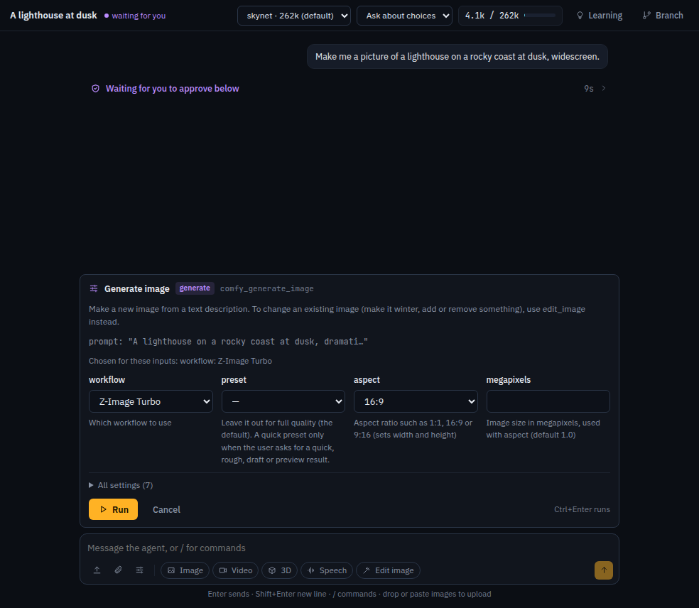
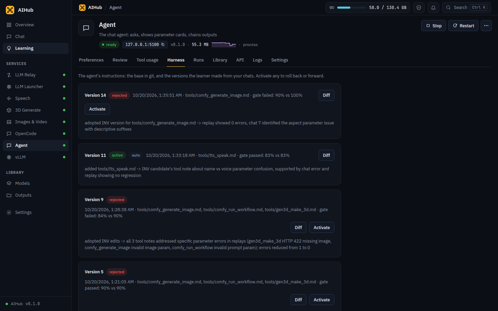
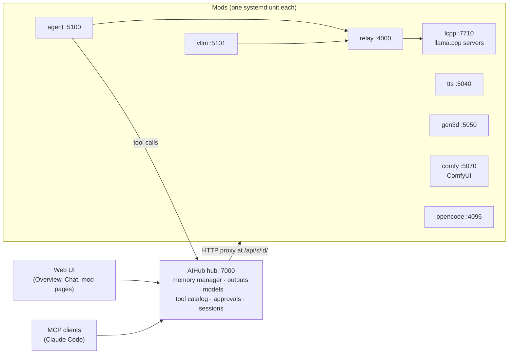

# AIHub

One local web app that runs and controls every AI service on a single machine: local LLMs,
image and video generation, 3D models, speech, and a chat agent that chains them together.


AIHub is a small FastAPI server (the *hub*) on `127.0.0.1:7000` in front of a set of **mods**.
A mod is one AI service in its own folder under `services/`, running as its own process, with its
own Python environment. The hub starts and stops the mods, shares the GPU's memory between them,
keeps one index of everything they make, and serves a single UI for all of it. Adding a service
means adding a folder; the hub needs no code change.

It was built for one machine, an AMD Strix Halo box with about 121 GB of GPU-addressable unified memory,
where the services' Python and ROCm stacks conflict and can't share one environment. Each mod now declares
variants for other hardware too (NVIDIA CUDA, Intel XPU, Apple MPS, Vulkan, CPU), and setup picks the one your
machine can run: what runs where, and what has been tested, is in [docs/platforms.md](docs/platforms.md).

## What it does

| Mod | Port | What it is |
|-----|------|------------|
| LLM Relay (`relay`) | 4000 | An OpenAI-compatible endpoint in front of every LLM (local and remote), with routing and usage analytics |
| LLM Launcher (`lcpp`) | 7710 | Starts and manages llama.cpp model servers and publishes them to the relay |
| Speech (`tts`) | 5040 | Text to speech with Breeze TTS 2 and Kokoro, including voice cloning and voice design |
| 3D Generate (`gen3d`) | 5050 | 3D models from a picture (TRELLIS.2, Hunyuan3D 2.1, SAM 3D for people and objects) or from text (Cube3D), plus named parts and game rigs |
| Images & Video (`comfy`) | 5070 | ComfyUI workflows for text to image, image edits and video, as reusable workflow packs |
| OpenCode (`opencode`) | 4096 | The OpenCode agent server, behind the relay |
| Agent (`agent`) | 5100 | The chat agent: asks when a choice is missing, shows settings for approval, chains outputs, and learns how you like things done |
| vLLM (`vllm`) | 5101 | Serves Hugging Face models with vLLM, one profile at a time, and publishes them to the relay |

Around the mods, the hub provides:

- **A memory manager** that unloads idle mods to make room before a model loads, so jobs don't run
  out of memory (it never stops an LLM on its own).
- **One outputs index** of every image, video, 3D model and audio clip, with search and previews.
- **A models registry** of the weights on disk (`aihub models`).
- **Sessions:** named setups ("LLM work", "Video work") that save what runs and what's loaded, and
  switch between them through the memory manager.
- **A tool catalog** with risk levels and approvals, also served over MCP at `/mcp`, so Claude
  Code or another MCP client can use the same tools.

### The chat agent


The Chat page talks to the agent mod, a Claude-Code-style loop written for AIHub. Ask for
something ("make a 3D model of a ceramic teapot, picture first") and it picks the tools and chains
them, one output feeding the next. Each turn folds into one tidy line ("Ran 2 tools · 3m 47s") that
opens into its steps, with the outputs in a strip underneath. Result cards have buttons for the
obvious next step (animate, edit, make 3D, remove background, describe), and later turns can refer
back to earlier outputs by number.

<p>
  
  
</p>

Before anything runs on the GPU, a parameter card docks above the composer (left). The agent
fills in what it can, picks a workflow or 3D engine that can actually do the job (picture to 3D,
text to 3D, an edit with reference pictures), and you change anything before pressing Run. Image
edits run at full quality unless you ask for a quick draft (right).



The agent learns from use. When you change the same setting on cards in two chats, it offers to
remember it, and from then on cards come pre-filled and marked "from your preferences". Thumbs on
replies and outputs count too. Overnight, or after an hour without a chat, it reviews recent chats,
tries changes to its own instructions, replays your chats under them, and keeps only what passes
its evaluation. The Learning page shows all of it, and any version can be rolled back with one
click. Each chat has a switch to leave it out.

On a 46-task scripted evaluation run three times on MiniCPM-V 4.7, the agent passed 85% of tasks
every time, and live runs that really generate (a local edit, picture to 3D with each engine, text
to 3D) all pass. Details and the remaining failures: [docs/agent-eval.md](docs/agent-eval.md).

## Requirements

- Linux (systemd user services, or detached processes without systemd), Windows 11 through WSL2, or macOS on Apple Silicon ([docs/platforms.md](docs/platforms.md)); Python 3.11 or newer for the setup command, git and [uv](https://docs.astral.sh/uv/) (it fetches the Python 3.12+ that the hub and mods run on). Native Windows isn't supported.
- For the GPU mods, a GPU your mods' variants support: `aihub hardware` shows what AIHub finds, and [docs/platforms.md](docs/platforms.md) which variants are tested where. The host setup per machine is in [docs/setup/](docs/setup/README.md): [AMD Strix Halo](docs/setup/host.md) (where AIHub is built and tested; Images & Video and 3D Generate run there in the [`kyuz0/amd-strix-halo-comfyui`](https://hub.docker.com/r/kyuz0/amd-strix-halo-comfyui) image through podman/toolbox), [NVIDIA](docs/setup/host-linux-nvidia.md), [Intel](docs/setup/host-linux-intel.md), [WSL2](docs/setup/host-wsl2.md), [macOS](docs/setup/host-macos.md).
- The hub, and the relay, OpenCode, agent, web and workspace mods, need no GPU; Speech to Text (stt) runs without one too, only slower.
- Models are your choice, per mod: each mod's setup doc says what it runs, suggests a few, and says how to add your own. None are in the repository.

## Quickstart

```bash
git clone https://github.com/brendondgr/AIHub.git
cd AIHub
bin/aihub setup
```

`aihub setup` does the whole install: the hub (`uv sync`, then `aihub install`, which writes and starts the `aihub` systemd user service and links `aihub` into `~/.local/bin`), the host checks (it prints any `sudo` fixes for you to run; it never runs them), then the mods you pick from a list. It asks every question first (licences, which models), installs each mod, downloads the models you chose, asks for the agent's model once your relay has some, and checks each mod. If it stops, run it again: it resumes. Open <http://127.0.0.1:7000> when it's done.

To set up only some mods: `bin/aihub setup relay agent tts`; to see the plan first: `--plan`. An AI agent can run the same process for you (`--plan --json`, answers in a file, one JSON report; the `aihub-setup` skill): the steps and questions are the same as yours. The guide behind it, and each mod's own setup doc, are in [docs/setup/](docs/setup/README.md).

## Usage

The UI covers everyday use: the Overview dashboard, a page per mod (each with an API tab generated
from its OpenAPI), Chat, Models, Outputs and Settings. The command line covers the rest:

| Command | What it does |
|---------|--------------|
| `aihub status` | The hub and each mod: state, load, port, memory |
| `aihub setup [<mod>…] [--plan] [--json]` | Set up the hub, the host checks and the mods you choose with their models (`docs/setup/`); `--plan` only shows the plan, `--json` is for an agent; it resumes after a stop |
| `aihub check <id> [--start]` | Check a mod against the contract (manifest, port, health, status, widgets, tools); `--start` starts it first, since a stopped mod's live checks are skipped |
| `aihub start \| stop \| restart [id \| all]` | The hub (no id), one mod, or every mod |
| `aihub load \| unload <id>` | Load a mod's models into memory, or free them |
| `aihub logs [id] [-f]` | A mod's log (`data/logs/<id>.log`), or the hub's |
| `aihub doctor [--inventory]` | Check the install; `--inventory` lists every path used outside the project |
| `aihub models list \| show <id> \| scan [--add] \| verify <id>…` | The models registry |
| `aihub backup <folder>` | Databases, registry, `config.toml` and the mods' `.env` files in a dated archive |
| `aihub open` | Open the UI in a browser |

The hub's own API is documented at <http://127.0.0.1:7000/api/docs>, and each mod's API is proxied
at `/api/s/<id>/`.

## How it works



Mods talk to the hub only over HTTP and never import each other's code. A mod declares itself in
`services/<id>/service.toml`: its command, port, health route, and optional extras such as a status
route, Overview widgets, agent tools and its own UI page. Before a mod loads a model, it asks the hub
for memory; the hub unloads idle mods in a configured order until the model fits under a 12 GB reserve.
The agent never calls a mod directly. Its tool calls go through the hub's catalog, which checks
permissions and turns anything that generates into an approval card.

The full design is in [docs/architecture.md](docs/architecture.md), and what exists file by
file is in [docs/structure.md](docs/structure.md).

## Configuration

Settings live in `config.toml` at the repository root, made from `config.example.toml` on the first run and not in git (the Settings page edits it and keeps its
comments). The main ones:

| Setting | Default | Meaning |
|---------|---------|---------|
| `hub.host`, `hub.port` | `127.0.0.1`, `7000` | Where the hub listens. Only loopback addresses are accepted |
| `paths.models`, `paths.databases`, `paths.outputs` | `data/models`, `data/databases`, `outputs` | Data folders; they must stay inside the project |
| `memory.reserve_gb` | `12` | Memory always kept free |
| `memory.auto_make_room` | `false` | `false` asks before unloading idle mods; `true` does it automatically |
| `memory.priority` | `["comfy", "tts", "gen3d"]` | Which mods are unloaded first |
| `services.<id>.autostart`, `.idle_unload_s` | per mod | Start with the hub; unload after this many idle seconds |
| `agent.permissions.deny / ask / allow` | `allow = ["hub_start_service"]` | Tool-name patterns, checked before the tool's risk level |
| `sessions.restore_on_boot` | `false` | Restore the setup from before the last restart when the hub starts |
| `sessions.autosave_s` | `300` | How often the current setup is saved as "Last session" |

Mods with secrets or machine-specific paths read a `.env` in their folder; the templates are
`services/relay/.env.example`, `services/tts/localtts.env.example` and
`services/gen3d/gen3d.env.example`. The `.env` files are gitignored.

## Adding a mod

```bash
aihub new my-mod
```

This creates `services/my-mod/` from the template, installs it and loads it. Edit its `server.py`
and `service.toml`, then run `aihub restart my-mod` and `aihub check my-mod` until the check reports
"all checks passed". Any language works as long as it serves HTTP on the given port with a health
route. The contract and the optional extras are in [docs/mods.md](docs/mods.md). ComfyUI workflows
are added as packs under `services/comfy/workflows/`, described in [docs/workflows.md](docs/workflows.md).

## Development

```bash
uv run pytest                                          # the hub, including the UI's Node tests
cd services/agent && .venv/bin/python -m pytest        # each mod has its own suite
```

The hub's suite has 526 tests, and each mod has its own suite on top. Fakes stand in for
real mods and models, so none of them need a GPU. The build plan, with every step and its checks,
is [docs/backend-plan.md](docs/backend-plan.md). The UI is plain ES modules on React with no build
step (`web/`), and [docs/design-brief-ui.md](docs/design-brief-ui.md) describes it.

## Status

A personal project, in daily use on the machine it was built for. As of October 2026, the plan is built
through Phase 22: the hub, the eight mods, the tool catalog and MCP endpoint, the chat agent and its
learner, sessions, and logs and runtime state kept inside the project folder. Known gaps:

- The GPU mods are tested on a Strix Halo with ROCm; their variants for NVIDIA, Intel, Apple and the CPU
  are written but untested until a field test (`aihub report`) runs them on that hardware
  ([docs/platforms.md](docs/platforms.md)). vLLM runs on ROCm only.
- Two paths still live outside the project folder: OpenCode's working directory
  (`OPENCODE_PROJECT_DIR`) and the LLM Launcher's CLI, installed as a uv tool.
- The memory manager schedules memory, not GPU compute: two mods can still compute at the same time
  and slow each other down.

## License

<!-- TODO: choose a license. Until one is added, all rights are reserved. -->
No license has been chosen yet.
