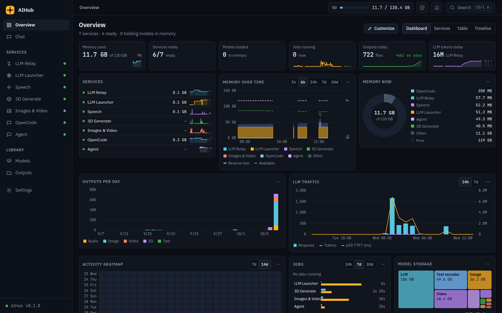
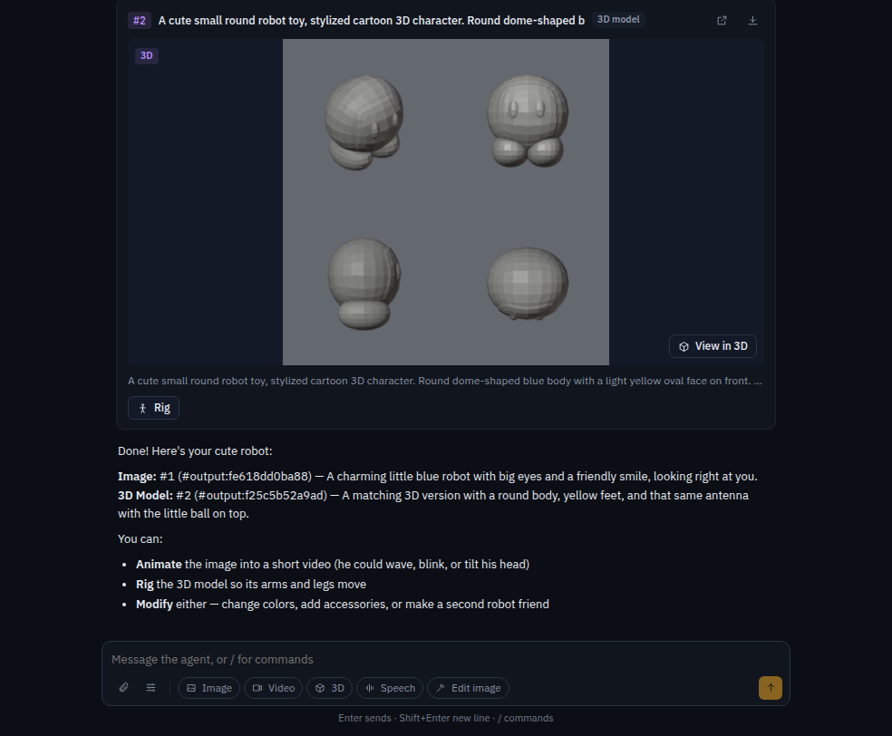
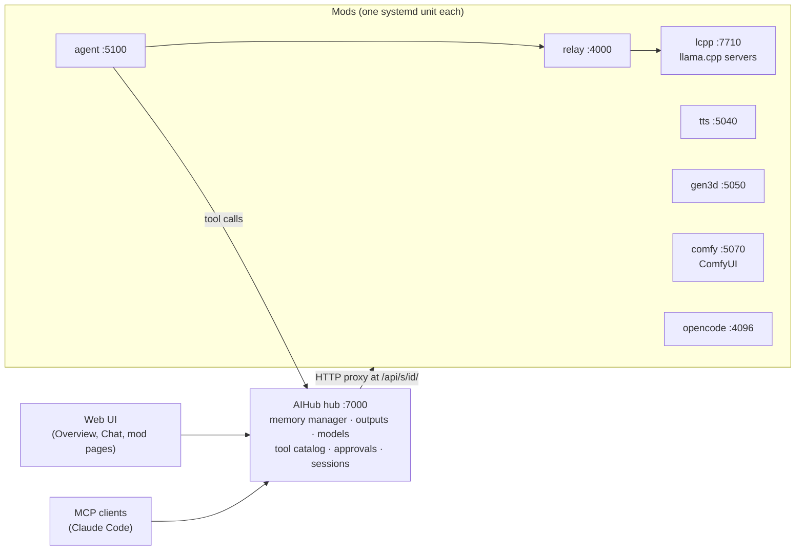

# AIHub

One local web app that runs and controls every AI service on a single machine: local LLMs,
image and video generation, 3D models, speech, and a chat agent that chains them together.



AIHub is a small FastAPI server (the *hub*) on `127.0.0.1:7000` in front of a set of **mods**.
A mod is one AI service in its own folder under `services/`, running as its own process, with its
own Python environment. The hub starts and stops the mods, shares the GPU's memory between them,
keeps one index of everything they make, and serves a single UI for all of it. Adding a service
means adding a folder; the hub needs no code change.

It was built for one machine, an AMD Strix Halo box with about 121 GB of GPU-addressable unified memory,
where the services' Python and ROCm stacks conflict and can't share one environment.

## What it does

| Mod | Port | What it is |
|-----|------|------------|
| LLM Relay (`relay`) | 4000 | An OpenAI-compatible endpoint in front of every LLM (local and remote), with routing and usage analytics |
| LLM Launcher (`lcpp`) | 7710 | Starts and manages llama.cpp model servers and publishes them to the relay |
| Speech (`tts`) | 5040 | Text to speech with Breeze TTS 2 and Kokoro, including voice cloning and voice design |
| 3D Generate (`gen3d`) | 5050 | Text to 3D meshes, named parts and game rigs (Cube3D and CubePart) |
| Images & Video (`comfy`) | 5070 | ComfyUI workflows for text to image, image edits and video, as reusable workflow packs |
| OpenCode (`opencode`) | 4096 | The OpenCode agent server, behind the relay |
| Agent (`agent`) | 5100 | The chat agent: asks when a choice is missing, shows settings for approval, and chains outputs |

Around the mods, the hub provides:

- **A memory manager** that unloads idle mods to make room before a model loads, so jobs don't run
  out of memory (it never stops an LLM on its own).
- **One outputs index** of every image, video, 3D model and audio clip, with search and previews.
- **A models registry** of the weights on disk (`aihub models`).
- **Sessions:** named setups ("LLM work", "Video work") that save what runs and what's loaded, and
  switch between them through the memory manager.
- **A tool catalog** with risk levels and approvals, also served over MCP at `/mcp`, so Claude
  Code or another MCP client can use the same tools.

### The chat agent



The Chat page talks to the agent mod, a Claude-Code-style loop written for AIHub. Ask for
something ("make an image of a robot toy, then turn it into a 3D model") and it picks the tools, asks
with a question card when a choice is missing, and shows a parameter card you approve or edit before
anything runs on the GPU. Each result card has buttons for the obvious next step (animate, edit, make
3D, remove background), and later turns can refer back to earlier outputs.

On a 30-task scripted evaluation run three times, Gemma 4 31B passed 26 of 30 tasks every time (87%)
and the local Gemma 4 26B passed 24 (80%). Details and the remaining failures:
[docs/agent-eval.md](docs/agent-eval.md).

## Requirements

- Linux with systemd user services (the hub and every mod run as `systemd --user` units).
- [uv](https://docs.astral.sh/uv/) for every Python environment. It fetches Python itself; the
  hub needs Python ≥ 3.12.
- For the GPU mods, the hardware AIHub was built on: an AMD Strix Halo (gfx1151) with ROCm.
  Images & Video and 3D Generate run in the
  [`kyuz0/amd-strix-halo-comfyui`](https://hub.docker.com/r/kyuz0/amd-strix-halo-comfyui) image
  through podman/toolbox. The LLM Launcher needs `llama-server` (llama.cpp) installed.
- Node.js and npm, to build the relay's web UI during `aihub install relay`.
- Model weights in `data/models/` (about 190 GB for the full set). They are not in the repository.

The hub itself and the relay, OpenCode and agent mods have no GPU requirement.

## Quickstart

```bash
git clone git@github.com:brendondgr/AIHub.git
cd AIHub
uv sync
bin/aihub install
```

`aihub install` writes and starts the `aihub` systemd user service and links `aihub` into
`~/.local/bin`. Open <http://127.0.0.1:7000>: the Overview lists the mods. Each mod sets up its own
environment with:

```bash
aihub install relay
aihub install agent
aihub start all
```

Repeat `aihub install <id>` for `lcpp`, `tts`, `gen3d` and `comfy`. Speech and 3D Generate also build
their model runtimes with `services/tts/scripts/install-runtime.sh` and
`services/gen3d/scripts/install-runtime.sh`. Then run `aihub doctor`, which checks the whole install
and says what's missing.

## Usage

The UI covers everyday use: the Overview dashboard, a page per mod (each with an API tab generated
from its OpenAPI), Chat, Models, Outputs and Settings. The command line covers the rest:

| Command | What it does |
|---------|--------------|
| `aihub status` | The hub and each mod: state, load, port, memory |
| `aihub start \| stop \| restart [id \| all]` | The hub (no id), one mod, or every mod |
| `aihub load \| unload <id>` | Load a mod's models into memory, or free them |
| `aihub logs [id] [-f]` | A mod's log (`data/logs/<id>.log`), or the hub's |
| `aihub doctor [--inventory]` | Check the install; `--inventory` lists every path used outside the project |
| `aihub models list \| show <id> \| scan [--add] \| verify <id>…` | The models registry |
| `aihub backup <folder>` | Databases, registry, `config.toml` and the mods' `.env` files in a dated archive |
| `aihub open` | Open the UI in a browser |

The hub's own API is documented at <http://127.0.0.1:7000/api/docs>, and each mod's API is proxied
at `/api/s/<id>/`.

## How it works



Mods talk to the hub only over HTTP and never import each other's code. A mod declares itself in
`services/<id>/service.toml`: its command, port, health route, and optional extras such as a status
route, Overview widgets, agent tools and its own UI page. Before a mod loads a model, it asks the hub
for memory; the hub unloads idle mods in a configured order until the model fits under a 12 GB reserve.
The agent never calls a mod directly. Its tool calls go through the hub's catalog, which checks
permissions and turns anything that generates into an approval card.

The full design is in [docs/architecture.md](docs/architecture.md), and what exists file by
file is in [docs/structure.md](docs/structure.md).

## Configuration

Settings live in `config.toml` at the repository root (the Settings page edits it and keeps its
comments). The main ones:

| Setting | Default | Meaning |
|---------|---------|---------|
| `hub.host`, `hub.port` | `127.0.0.1`, `7000` | Where the hub listens. Only loopback addresses are accepted |
| `paths.models`, `paths.databases`, `paths.outputs` | `data/models`, `data/databases`, `outputs` | Data folders; they must stay inside the project |
| `memory.reserve_gb` | `12` | Memory always kept free |
| `memory.auto_make_room` | `false` | `false` asks before unloading idle mods; `true` does it automatically |
| `memory.priority` | `["comfy", "tts", "gen3d"]` | Which mods are unloaded first |
| `services.<id>.autostart`, `.idle_unload_s` | per mod | Start with the hub; unload after this many idle seconds |
| `agent.permissions.deny / ask / allow` | `allow = ["hub_start_service"]` | Tool-name patterns, checked before the tool's risk level |
| `sessions.restore_on_boot` | `false` | Restore the setup from before the last restart when the hub starts |
| `sessions.autosave_s` | `300` | How often the current setup is saved as "Last session" |

Mods with secrets or machine-specific paths read a `.env` in their folder; the templates are
`services/relay/.env.example`, `services/tts/localtts.env.example` and
`services/gen3d/gen3d.env.example`. The `.env` files are gitignored.

## Adding a mod

```bash
aihub new my-mod
```

This creates `services/my-mod/` from the template, installs it and loads it. Edit its `server.py`
and `service.toml`, then run `aihub restart my-mod` and `aihub check my-mod` until the check reports
"all checks passed". Any language works as long as it serves HTTP on the given port with a health
route. The contract and the optional extras are in [docs/mods.md](docs/mods.md). ComfyUI workflows
are added as packs under `services/comfy/workflows/`, described in [docs/workflows.md](docs/workflows.md).

## Development

```bash
uv run pytest                                          # the hub, including the UI's Node tests
cd services/agent && .venv/bin/python -m pytest        # each mod has its own suite
```

The hub's suite has 495 tests, and the mods' suites add 522 more. Fakes stand in for
real mods and models, so none of them need a GPU. The build plan, with every step and its checks,
is [docs/backend-plan.md](docs/backend-plan.md). The UI is plain ES modules on React with no build
step (`web/`), and [docs/design-brief-ui.md](docs/design-brief-ui.md) describes it.

## Status

A personal project, in daily use on the machine it was built for. As of October 2026, all 16 phases
of the plan are built: the hub, the seven mods, the tool catalog and MCP endpoint, the chat agent,
sessions, and logs and runtime state kept inside the project folder. Known gaps:

- The GPU mods assume a Strix Halo with ROCm and the kyuz0 container image; other hardware would
  need its own images and model choices.
- Two paths still live outside the project folder: OpenCode's working directory
  (`OPENCODE_PROJECT_DIR`) and the LLM Launcher's CLI, installed as a uv tool.
- The memory manager schedules memory, not GPU compute: two mods can still compute at the same time
  and slow each other down.

## License

<!-- TODO: choose a license. Until one is added, all rights are reserved. -->
No license has been chosen yet.
